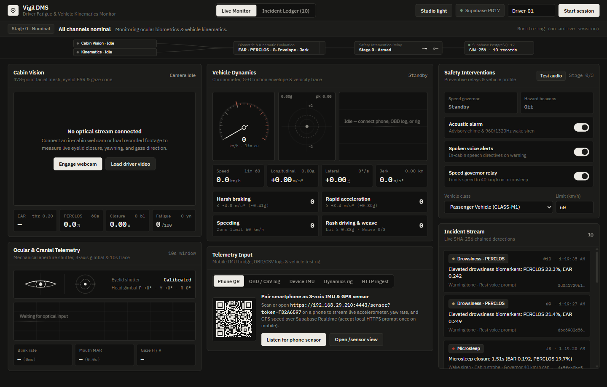
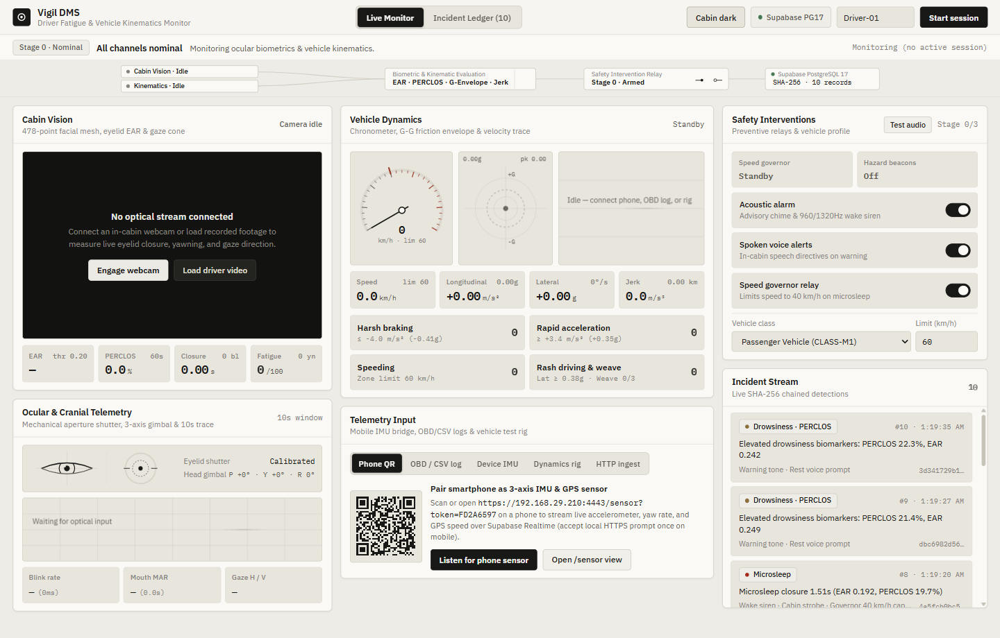
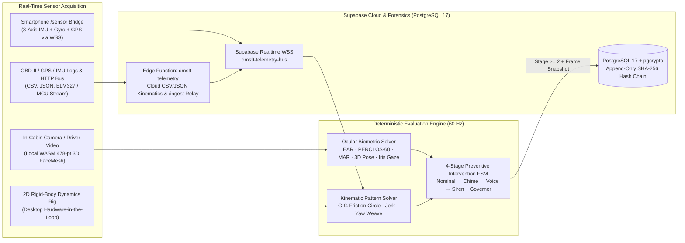

# Vigil DMS

**Real-Time Driver Fatigue Biometrics, Vehicle Kinematic Anomaly Detection, and Preventive Safety Intervention System**

Vigil DMS combines on-device 3D ocular computer vision with multi-channel vehicle kinematics to detect drowsiness, visual distraction, yawning, head droop, harsh braking, rapid acceleration, speeding, and rash driving in real time. Safety interventions escalate through a deterministic four-stage state machine backed by an append-only, SHA-256 hash-chained PostgreSQL 17 forensic ledger on Supabase.

---

## Interface Overview

### Cabin Dark Surface (Low-Glare In-Vehicle Mode)


### Studio Light Surface (Control Room & Fleet Audit Mode)


---

## System Architecture



---

## Engineering Specifications

### 1. Ocular Fatigue & Distraction Pipeline (`src/engines/ocularEngine.ts`)

Inference runs locally in WebAssembly/WebGL using Google MediaPipe `FaceLandmarker` (`/public/wasm` + `/public/models/face_landmarker.task`), requiring zero external model CDN requests at runtime.

- **Bilateral Eye Aspect Ratio (EAR)**: Computed across canonical 6-point eyelid contours (`[33, 160, 158, 133, 153, 144]` left, `[362, 385, 387, 263, 373, 380]` right) following Soukupová & Čech (2016), cross-checked against neural eyelid closure blendshapes (`eyeBlinkLeft`, `eyeBlinkRight`) to prevent false triggers under angled eyewear:

$$\mathrm{EAR} = \frac{\lVert p_2 - p_6 \rVert + \lVert p_3 - p_5 \rVert}{2 \lVert p_1 - p_4 \rVert}$$

- **Personal 3-Second Neutral Baseline Calibration**: Samples resting $\mathrm{EAR}_0$ (65th percentile to reject incidental blinks) and neutral head orientation $(\theta_{p0}, \theta_{y0}, \theta_{r0})$, setting a personalized closure threshold $\mathrm{EAR}_{\text{thr}} = 0.72 \times \mathrm{EAR}_0$.
- **Blink vs. Drowsiness vs. Microsleep Separation**:
  - `85 ms – 550 ms`: Counted as physiological blink; tracks rolling blinks/minute and blink duration (prolonged blinks `> 300 ms` contribute to early fatigue scoring).
  - `>= 800 ms`: Stage-2 Drowsy Closure warning.
  - `>= 1500 ms`: Stage-3 Critical Microsleep intervention.
- **Rolling 60-Second PERCLOS (P80)**: Computes the proportion of frame time within a sliding 60-second window where eyelids remain closed past the calibrated P80 threshold (`>= 12%` advisory, `>= 20%` drowsiness warning).
- **Mouth Aspect Ratio (MAR) & Temporal Yawn Filter**: Evaluates vertical-to-horizontal inner lip aperture (`[13, 14]`, `[81, 178]`, `[311, 402]` over `[78, 308]`). Requires continuous hold `>= 1.6 s` above `0.54` MAR so speech does not misclassify as yawning.
- **Adaptive Night-Vision / Low-Light Signal Restoration (`Night IR`, up to `+18.0 dB`)**: Samples a 256-bin luminance histogram on every frame prior to inference (`< 86` luma auto-engage with hysteresis at `> 98` luma, plus manual `Auto / On / Off`). Applies `2nd–98.5th` percentile histogram stretching, balanced shadow-lift gamma (`0.66–0.84`), and an S-curve micro-contrast lookup table into an offscreen Near-IR canvas passed directly into `FaceLandmarker.detectForVideo(...)`—preserving full 478-point landmark lock, eyelid EAR accuracy, and clear JPEG incident snapshots in dark night cabins.
- **3D Cranial Pose & Iris Gaze Cone**: Decomposes the 4×4 column-major facial transformation matrix into Euler `Pitch`, `Yaw`, and `Roll` angles while measuring iris center offsets (`landmarks 468 & 473`) inside each eye socket to flag head nodding (`pitch <= -15.5°` for `>= 1.2 s`) and off-road visual distraction (`|yaw| >= 24°` or extreme iris deviation for `>= 1.5 s`).

---

### 2. Vehicle Kinematics & Risky Driving Detection (`src/engines/kinematicEngine.ts`, `server/kinematics.mjs`)

Startup state displays `0.0 km/h` and `Standby` with zero synthetic or pre-filled data. Real motion telemetry can be supplied through five channels:

1. **Smartphone Field Sensor (`/sensor`)**: Scan the cockpit QR code on an iOS or Android phone. Streams hardware `DeviceMotionEvent` 3-axis linear acceleration, gyroscope yaw rate, and HTML5 `Geolocation` ground speed over **Supabase Realtime WSS** (works across cellular 4G/5G and isolated Wi-Fi networks). Includes **Screen Wake Lock** (`navigator.wakeLock`) and one-tap **Mount Gravity Tare** to zero out static dashboard tilt.
2. **OBD-II / IMU / GPS File Analyzer**: Parses `.csv` and `.json` exports from OBD-II scanners, Phyphox, Sensor Logger, or raw GPS tracks (`timestamp, lat, lon`), deriving geodesic Haversine ground speed, bearing yaw rate $\omega_z$, longitudinal acceleration $dv/dt$, centripetal lateral acceleration $v \cdot \omega_z$, and jerk $|d\vec{a}/dt|$, with `1x / 2x / 4x` oscilloscope replay.
3. **Local Device Hardware IMU & GPS**: Binds native browser `DeviceMotionEvent` and `Geolocation` directly on tablets and sensor-equipped laptops.
4. **Cloud HTTP Hardware Ingest Endpoint**: Accepts live JSON telemetry frames from ELM327 scripts, Raspberry Pi units, or ESP32 microcontrollers via `POST /functions/v1/dms9-telemetry/ingest`.
5. **Manual 2D Bicycle-Model Dynamics Rig**: Opt-in keyboard/touch rigid-body physics testbench (`W` throttle, `Shift+W` kickdown surge, `S` service brake, `Space` emergency brake, `A/D` steering) for desktop verification of thresholds and throttle governor interventions.

#### Default Passenger Vehicle (`CLASS-M1`) Thresholds

| Pattern | Trigger Condition | Default Threshold |
| :--- | :--- | :--- |
| **Harsh Braking** | Longitudinal deceleration $a_{\text{long}}$ | $\le -3.8\text{ m/s}^2$ (`-0.39g`) |
| **Rapid Acceleration** | Longitudinal surge $a_{\text{long}}$ | $\ge +3.4\text{ m/s}^2$ (`+0.35g`) |
| **Speeding** | Ground velocity $v > v_{\text{limit}} + 2\text{ km/h}$ | `60 km/h` (`1.2 s` hysteresis or `+15 km/h` acute) |
| **Rash Driving & Weave** | Lateral load, control jerk, friction circle, or slalom | $\|a_{\text{lat}}\| \ge 0.38g$, $\|j\| \ge 6.5\text{ m/s}^3$, or $\ge 3$ yaw flips `> 18°/s` in `8 s` |

Built-in presets also cover **Heavy Freight Haulage (`CLASS-N3`)**, **Passenger Transit Coach (`CLASS-M3`)**, and **Restricted Campus Zone (`25 km/h`)**, with all 10 sensitivity sliders persisted to Supabase.

---

### 3. Four-Stage Preventive Safety Interventions (`src/engines/interventionEngine.ts`)

| Stage | State | Cabin & Vehicle Actions |
| :--- | :--- | :--- |
| **Stage 0** | `Nominal` | Quiet dark-cockpit discipline; zero unnecessary color or audio distraction. |
| **Stage 1** | `Advisory` | Dual-tone Web Audio harmonic chime (`523 Hz → 659 Hz`) + HUD posture/early-fatigue prompt. |
| **Stage 2** | `Active Warning` | Pulsed warning cadence + spoken cabin `SpeechSynthesis` directive + incident committed to Supabase with JPEG camera frame snapshot. |
| **Stage 3** | `Critical Intervention` | Alternating `960 / 1320 Hz` wake siren + peripheral cabin border strobe + **Speed Governor cap (`40 km/h`)** + **4-Way Hazard Beacons** + unacknowledged microsleep safe-deceleration assist. |
| **Emergency SOS** | `Unresponsive / 1-Tap SOS` | Automatic **5-second Auto-SOS countdown** on unrecovered Stage-3 microsleep (plus 1-tap manual dial in cockpit & `/sensor` mobile node) invoking native `tel:` voice dialing (default `+917389416622`), ITU `400/425 Hz` ringback + spoken confirmation, `SMS GPS` / `WhatsApp SOS` coordinate links, and `EMERGENCY_SOS` SHA-256 ledger logging (with local SQLite fallback when offline). |

Clearing a Stage-3 microsleep lockout requires **2.5 seconds of continuous open-eye forward gaze** verified by the ocular engine (or explicit manual operator reset).

---

### 4. Tamper-Evident Supabase PostgreSQL 17 Ledger (`supabase/migrations/`)

- **Append-Only Row Level Security**: `public.dms9_incidents` permits `SELECT` and `INSERT` only; direct `UPDATE` and `DELETE` operations are blocked by RLS policy.
- **Database-Enforced SHA-256 Chaining**: A `BEFORE INSERT` PostgreSQL trigger (`dms9_chain_incident_hash()`) locks the sequence head and computes `entry_hash` inside Postgres via `pgcrypto`:

$$H_n = \mathrm{SHA256}\left(H_{n-1} \mathbin{\|} \mathrm{id} \mathbin{\|} \mathrm{session\_id} \mathbin{\|} t_{\text{iso}} \mathbin{\|} \mathrm{category} \mathbin{\|} \mathrm{severity} \mathbin{\|} \mathrm{stage} \mathbin{\|} \mathrm{summary} \mathbin{\|} \mathrm{action} \mathbin{\|} \mathrm{metrics}\right)$$

- **One-Click Cryptographic Verification**: Calling `supabase.rpc('dms9_verify_ledger')` recomputes every digest from the 64-zero genesis hash on the database server and reports integrity status, row count, head SHA-256 digest, and execution time in milliseconds.

---

## Repository Layout

```text
Vigil-Dms/
├── public/                        # Auto-populated local MediaPipe WASM & FaceLandmarker model
├── scripts/
│   └── prepare-assets.mjs         # Copies WASM runtime & downloads face_landmarker.task on build
├── server/
│   ├── index.mjs                  # Express HTTP (:4400) + Mobile Sensor HTTPS (:4443) + WS server
│   ├── db.mjs                     # Local Node v24 SQLite mirror & offline fallback
│   ├── kinematics.mjs             # Deterministic CSV/JSON Haversine & finite-difference parser
│   └── kinematics.test.mjs        # Automated physics & SHA-256 chain unit tests
├── src/
│   ├── components/
│   │   ├── OpticalViewport.tsx    # Live webcam / video HUD, vernier reticles & shutter blades
│   │   ├── OcularGimbalRig.tsx    # Mechanical eye-aperture shutter & 3-axis head-pose gimbal
│   │   ├── BiometricOscilloscope.tsx
│   │   ├── VelocityChronometer.tsx# 240-deg speedometer dial, limit detent & governor sector
│   │   ├── KinematicScopes.tsx    # Polar G-G friction circle & velocity/acceleration strip
│   │   ├── SignalSchematicBus.tsx # Cubic-Bezier signal pipeline & animated relay switch
│   │   ├── SlidingSegmentedControl.tsx
│   │   ├── OdometerValue.tsx      # Rolling 0-9 mechanical digit drums
│   │   ├── TelemetrySourceDeck.tsx
│   │   ├── InterventionMatrix.tsx
│   │   ├── BlackboxLedger.tsx     # SHA-256 chain verifier, audit export & threshold sliders
│   │   └── MobileSensorNode.tsx   # Handheld /sensor smartphone IMU/GPS Realtime transmitter
│   ├── engines/
│   │   ├── ocularEngine.ts        # 478-pt EAR, MAR, PERCLOS-60, 3D pose & iris gaze solver
│   │   ├── kinematicEngine.ts     # Multi-source vehicle kinematics & 2D bicycle-model rig
│   │   └── interventionEngine.ts  # 4-stage escalation FSM, Web Audio synth & voice callouts
│   ├── lib/
│   │   ├── supabase.ts            # Supabase Postgres, Edge Function & Realtime WSS client
│   │   └── formatters.ts
│   └── styles/
│       ├── tokens.css             # Cabin Dark & Studio Light industrial design tokens
│       └── cockpit.css
└── supabase/
    ├── migrations/
    │   └── 20261124000001_vigil_dms_schema.sql
    └── functions/
        └── dms9-telemetry/
            └── index.ts           # Supabase Edge Function for log analysis & /ingest relay
```

---

## Getting Started

### Prerequisites
- **Node.js 22.5+ / 24+** (uses native `node:sqlite` for local server state alongside Supabase)
- A **Supabase** project (PostgreSQL 15/17 with `pgcrypto` and Realtime enabled)

### 1. Install Dependencies & Local Vision Assets

```bash
git clone https://github.com/Sunil56224972/Vigil-Dms.git
cd Vigil-Dms
npm install
npm run setup
```

`npm run setup` copies the MediaPipe WebAssembly binaries into `public/wasm/` and downloads `face_landmarker.task` into `public/models/` so ocular inference runs completely offline in the browser.

### 2. Configure Supabase Backend

1. Run the SQL migration in [`supabase/migrations/20261124000001_vigil_dms_schema.sql`](supabase/migrations/20261124000001_vigil_dms_schema.sql) inside your Supabase SQL Editor.
2. Deploy the optional cloud telemetry Edge Function (`supabase functions deploy dms9-telemetry --no-verify-jwt`).
3. Copy `.env.example` to `.env` and fill in your project credentials:

```env
VITE_SUPABASE_URL=https://your-project-ref.supabase.co
VITE_SUPABASE_ANON_KEY=your-supabase-anon-or-publishable-key
VITE_SUPABASE_EDGE_URL=https://your-project-ref.supabase.co/functions/v1/dms9-telemetry
```

### 3. Build, Test & Launch

```bash
npm run test:kinematics
npm run build
npm start
```

- **Main Workstation**: `http://localhost:4400`
- **Smartphone Sensor Node (LAN HTTPS + Supabase Realtime)**: `https://<LAN-IP>:4443/sensor` (or `http://localhost:4400/sensor`)
- **Development Hot-Reload Mode**: `npm run dev`

---

## External Hardware Telemetry Ingest API

Stream live vehicle telemetry from an OBD-II script, CAN-bus gateway, or microcontroller directly to the Supabase Edge `/ingest` endpoint (or local `POST http://localhost:4400/api/telemetry/ingest`):

```bash
curl -X POST "https://<your-project-ref>.supabase.co/functions/v1/dms9-telemetry/ingest" \
  -H "Content-Type: application/json" \
  -d '{
    "nodeId": "OBD-CAN-01",
    "speedKmh": 78.4,
    "accelLongMs2": -4.6,
    "accelLatMs2": 0.4,
    "yawRateDegS": 3.2
  }'
```

---

## License

Released under the repository's [LICENSE](LICENSE).
